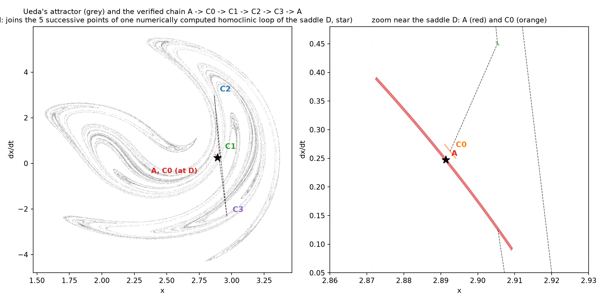
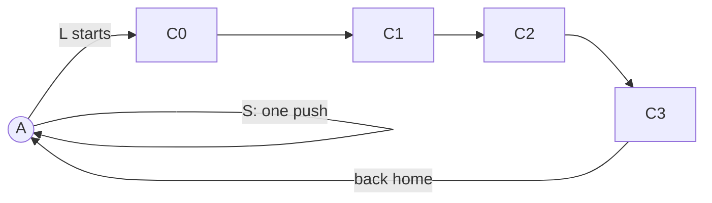

# Ueda's oscillator is chaotic: a computer-assisted proof

**Ueda's oscillator, a damped spring pushed back and forth and called chaotic for decades on the strength of simulations, is proved to have chaotic motions, with two independently written rigorous checkers.**

[](https://doi.org/10.5281/zenodo.23172757)  [](https://github.com/Hashirama1337s)

Moki & Julio · 2026 · version 1.0

**Read** [TECHNICAL.md](TECHNICAL.md) · **Re-run** `bash reproduce.sh` · **Check** [proof/design_chain.txt](proof/design_chain.txt)

## In plain words

Yoshisuke Ueda, at Kyoto University, studied a spring with a cubic restoring force and a little friction, pushed back
and forth once every 2π units of time. Written out, it is x'' + 0.05 x' + x^3 = 7.5 cos t. It became one of the
founding examples of chaos. Ueda's own account calls this setting the "representative" Ueda chaotic attractor.

For decades it was called chaotic on the strength of pictures and simulations. As far as we could find, nobody had
proved it. The usual pen-and-paper route (Melnikov's method) does not apply, and the analytic results we found for small
friction do not reach these values. Computer-assisted proofs existed for other forced oscillators, such as the forced
damped pendulum.

A picture that helps: **kneading dough.** A baker stretches the dough long, lays it back across itself and stretches
it again. Crumbs that start side by side can be sent along completely different routes. Here the "dough" is the set of possible states of the spring (where it
is and how fast it moves), and one push of the forcing does the stretching. We picked five small, thin boxes of states
and proved that one push stretches each box right across the next one on a fixed route map, overhanging both ends.

Once every link of the route map is proved, any route you choose through it is followed by a real motion. Where the
picture breaks: a baker mixes all the dough, but we prove the stretching only for these five thin boxes. The theorem
says nothing about most starting points, or about what a typical simulation settles into. It also says nothing about
how fast nearby states separate (no Lyapunov exponents).

"Proved" here means this. Every calculation returns a range that is guaranteed to contain the true value, with every
rounding error counted. Two programs, written separately, check the whole chain. Both say VERIFIED, and both reject
deliberately broken versions of the boxes.

## At a glance

*The exact claims, for specialists. Terms are explained in "How it works" and "Words you will meet".*

- **Theorem.** Let P be the stroboscopic map of x'' + 0.05 x' + x^3 = 7.5 cos t from t = 0 to t = 2π. There are five
  pairwise disjoint h-sets A, C0, C1, C2, C3 in the (x, x') plane (exact definitions in
  [`proof/design_chain.txt`](proof/design_chain.txt)) such that P satisfies the covering relations
  A ⇒ A and A ⇒ C0 ⇒ C1 ⇒ C2 ⇒ C3 ⇒ A, in the sense of Zgliczyński and Gidea.
- **Consequences.** Every S/L itinerary is realised; every periodic itinerary by a periodic orbit; P has a compact
  invariant set on which it is semi-conjugate to the subshift of finite type of this graph, so h_top(P) ≥ ln ρ ≈ 0.2812.
- **Checkers.** Checker A (CAPD Lohner sets, forcing as a rotating pair): 644 enclosures, 12 s, VERIFIED, also at
  Taylor orders 10 and 14. Checker B (written from [`independent/SPEC.md`](independent/SPEC.md) only, without access to
  checker A): 205 enclosures, 1.4 s, VERIFIED.
- **Controls.** Checker A rejects five broken designs (flipped last link, 10x narrower C3, 10x thinner band for C1,
  forcing 7.0, forcing 7.4); checker B rejects the two it runs.

Full theorem, margins per link, charts, history and prior work: [TECHNICAL.md](TECHNICAL.md).



## What we do not claim

- That almost every orbit is chaotic, or anything about Lyapunov exponents.
- That the attractor seen in simulations is this invariant set, or contains it.
- Ueda's hypothesis that the attractor is the closure of the unstable manifold of the saddle D.
- That D exists with the coordinates and multipliers quoted above (they are numerical), or that D has a homoclinic
  orbit. The theorem only gives some fixed point inside A.
- Anything at other parameter values. The rejected controls at forcing 7.0 and 7.4 show that *this design* fails
  there, not that the oscillator is regular there.
- Ueda's 1961 "broken egg" recording (a different equation) and his 1978 case (k, B) = (0.1, 12) are not covered.
- Both checkers use the CAPD library (our note; the same limit is stated in the laser-chaos repository), so a bug
  inside CAPD would affect both; the library controls guard against that only partly.

## How it works

### The idea

Look at the spring once per push, like a strobe light that flashes once per forcing cycle. Each flash shows a point in
a plane: position across, speed up. The rule that takes one flash to the next is the **stroboscopic map** P.

The route map has one "home" box A and four boxes C0 to C3 along a loop. From A, one push can keep the motion in A
(a short stay, **S**), or start a five-push loop through C0, C1, C2, C3 and back to A (a long loop, **L**).



The theorem: for **every** endless string of S's and L's, in any order, there is an exact solution of the equation
that follows it. Repeating strings give repeating motions, so there are infinitely many periodic orbits.

### A worked example

**Finding the boxes (not part of the proof).** Simulations show a saddle point D ≈ (2.891363, 0.246965) of the map:
one push stretches nearby states by about 13.0 in one direction and squeezes them by about 0.056 in the other. These
agree with the values Ueda lists to every printed digit. A point close to D leaves it along the stretching direction
and, four pushes later, lands on the incoming (squeezing) path into D. That numerical loop guided where the C boxes go.

**Each link is three checks.** For a link N ⇒ M, after one push:

- the left edge of N must land strictly beyond one side of M;
- the right edge must land strictly beyond the other side;
- the whole image of N must stay strictly inside M's thickness.

Together with "the five boxes do not overlap", these are the conditions of a theorem by Zgliczyński and Gidea (2004).

**A worked example.** The smallest margin in the table is the thickness check of the link C1 ⇒ C2. Checker B
proved the image stays inside with a spare margin of 2.87e-4, in the target box's own units. Every margin in the table
is positive; a single zero or negative one would sink the proof.

**Why one push per link.** A first design tried to jump from C0 straight back to D in one go. It failed, because over
those four pushes the map stretches by a factor of about 2,500. Splitting the loop into one-push links fixed it.

**How fast the patterns multiply.** An S lasts one push and an L lasts five, so the number of allowed patterns grows by
a factor of about ρ ≈ 1.3247 per push, the *plastic number* (the real root of x^3 = x + 1). That growth rate gives the
**topological entropy**: at least ln ρ ≈ 0.2812 per forcing period.

## Reproduce and reuse

Questions this lets you answer:

- Does the proof really check out on my machine, from the published files alone?
- Does the checker really fail when a box is wrong? (Break a box and watch.)
- What does a complete, two-checker covering-relation proof for a forced 2-D system look like, file by file? Checker A
  has already been reused this way: with the vector field and parameters replaced, it became the checker of our laser
  proof ([laser-chaos](https://github.com/Hashirama1337s/laser-chaos)).

**Re-run everything** (Linux or WSL, g++ ≥ 11, CMake, git). The script downloads and builds the CAPD library at a
pinned commit (most of the run time), then the proofs take seconds. On Windows, clone with `-c core.autocrlf=false` so the
shell script keeps its Unix line endings.

```
git clone -c core.autocrlf=false https://github.com/Hashirama1337s/ueda-chaos
cd ueda-chaos
bash reproduce.sh
```

It exits with status 0, and prints `REPRODUCE: ALL RESULTS AND CONTROLS AS STATED`, only if every proof verifies and
every negative control is rejected. If you already have CAPD built at commit
`03dc5628203334b214bb7d9fd63788a175521005`, `CAPD_DIR=/path/to/capd bash reproduce.sh` skips the build.

**Break a box and watch it fail.** After `reproduce.sh` has built checker A:

```
cd proof
./check_chain design_chain.txt 64 40                # ends: ALL COVERING RELATIONS AND DISJOINTNESS VERIFIED
./check_chain controls/neg_narrowC3.txt 64 40       # C3 made 10x narrower: ends NOT VERIFIED
```

`controls/neg_narrowC3.txt` is `design_chain.txt` with one box changed. Make your own change to a copy of the design
file (a box's width, its position) and run the checker on it. The choice of charts, box sizes and splitting can only
make a check fail, never pass falsely.

**Look at the attractor yourself** (non-rigorous, Python with numpy and matplotlib, from inside `design/`):
`attractor.py` draws it, `explore.py` finds the fixed points, `manifolds2.py` grows the unstable manifold.

## Words you will meet

- **Stroboscopic map** - the state of the system sampled once per forcing period, as under a strobe light.
- **Chaos (as proved here)** - a set of motions that can follow any pattern from a list of allowed patterns, with
  positive topological entropy.
- **Topological entropy** - how fast the number of distinguishable patterns grows per period, on a log scale.
- **h-set** - a thin box in the state plane with a "stretch" direction and a "squeeze" direction.
- **Covering relation (N ⇒ M)** - one period stretches box N right across box M, past both ends, while staying inside
  M's thickness.
- **Interval arithmetic** - computing with ranges that are guaranteed to contain the true value, rounding included.
- **Saddle point** - a state that pulls nearby states in along one direction and pushes them away along another.
- **Periodic orbit** - a motion that repeats exactly after a whole number of periods.
- **Negative control** - a deliberately broken input that the checker must reject; if it passed, the checker would be
  suspect.
- **CAPD** - a C++ library for rigorous computation with differential equations (Kapela et al. 2021).

## How to cite

```
Moki & Julio (2026). Ueda's oscillator is chaotic - a computer-assisted proof. Version 1.0. Zenodo. https://doi.org/10.5281/zenodo.23172757
```

The DOI always resolves to the newest archived version. Version 1.0 is 10.5281/zenodo.23172758. Machine-readable: [CITATION.cff](CITATION.cff).
Licences: text, figures and data are CC BY 4.0 (`LICENSE`); code is MIT (`LICENSE-CODE`). CAPD is used under its own licence and is not redistributed.

## Related projects

- [laser-chaos](https://github.com/Hashirama1337s/laser-chaos): a computer-assisted proof of a chaotic set in a loss-modulated laser model
- [rikitake-chaos](https://github.com/Hashirama1337s/rikitake-chaos): a computer-assisted proof of chaotic motions in Rikitake's two-disc dynamo
- All projects: [the Moki & Julio lab map](https://github.com/Hashirama1337s)

---

*Prepared with AI assistance; what was checked, and by what, is stated above.*
